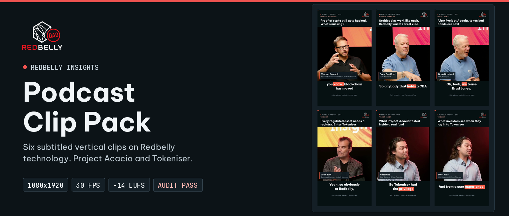
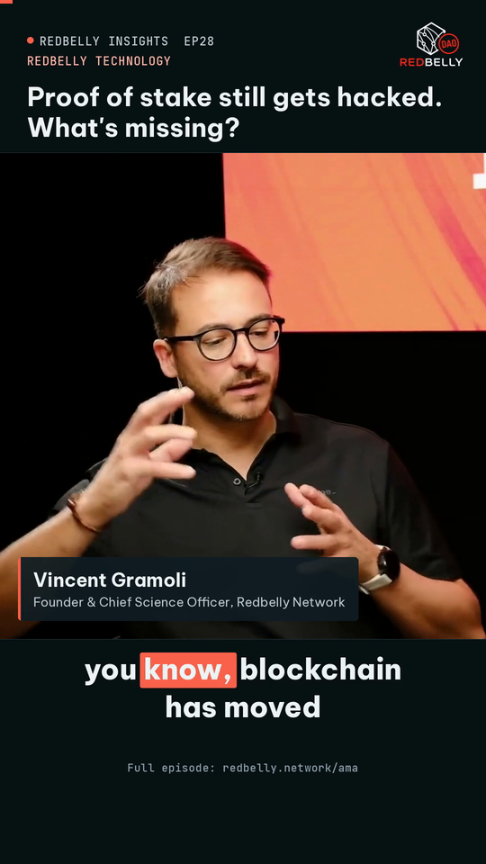
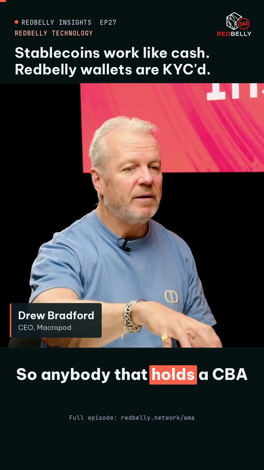
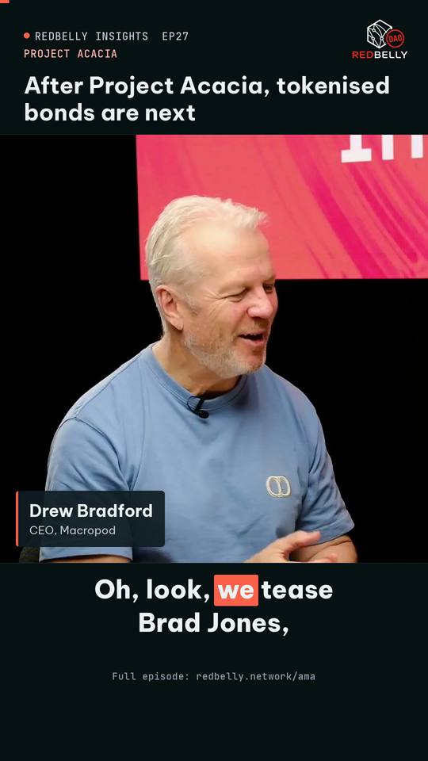
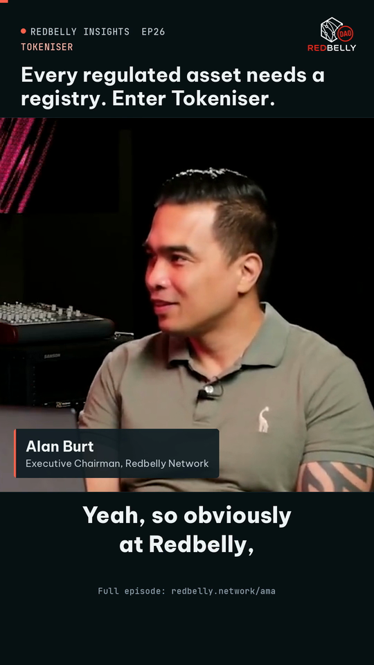
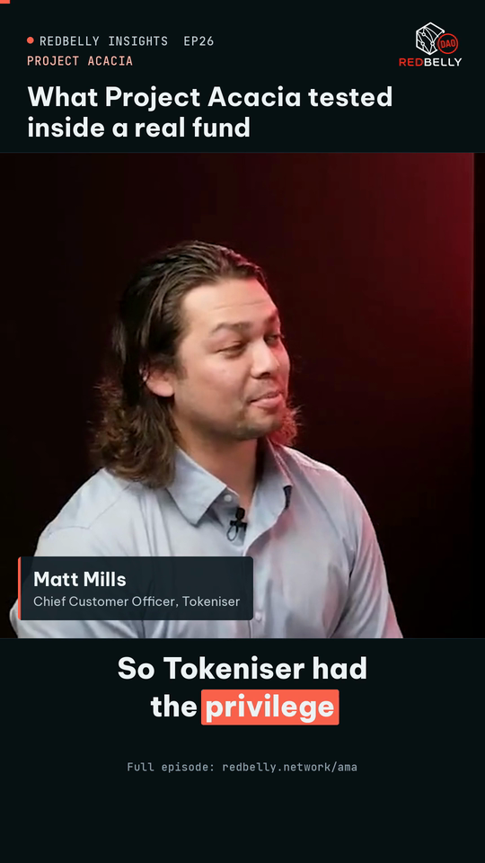
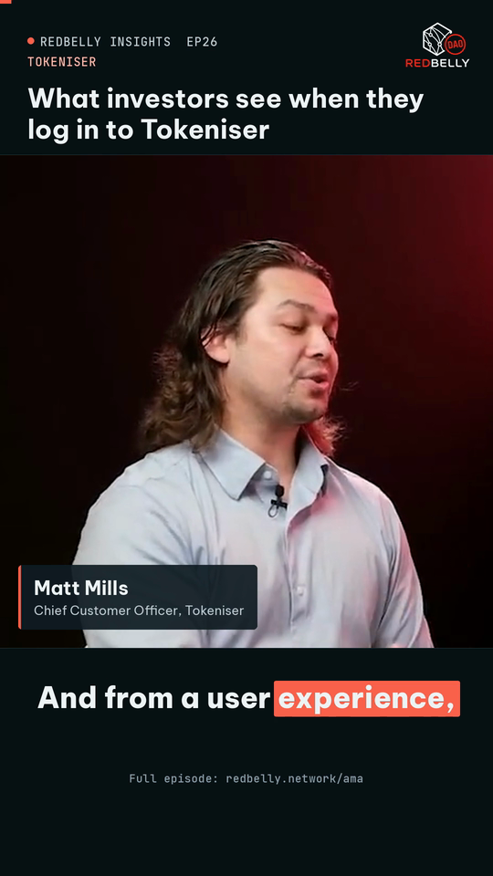
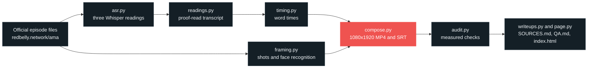

<p align="center">
  <a href="https://redbelly-podcast.vercel.app/"></a>
</p>

<p align="center">
  Six subtitled vertical clips from the latest official <b>Redbelly Insights</b> episodes,<br>
  each making one point about <b>Redbelly technology</b>, <b>Project Acacia</b> or <b>Tokeniser</b>.
</p>

<!-- badges:start -->
<p align="center">
  <a href="https://redbelly-podcast.vercel.app/"></a>
  <a href="QA.md"></a>
  <a href="SOURCES.md"></a>
  
  
  <a href="tests/test_deliverables.py"></a>
</p>
<!-- badges:end -->

<p align="center">
  <a href="https://redbelly-podcast.vercel.app/"><b>Review page</b></a>
  &nbsp;&nbsp;|&nbsp;&nbsp;
  <a href="SOURCES.md"><b>Sources and post captions</b></a>
  &nbsp;&nbsp;|&nbsp;&nbsp;
  <a href="QA.md"><b>QA report</b></a>
  &nbsp;&nbsp;|&nbsp;&nbsp;
  <a href="clips"><b>Clips</b></a>
  &nbsp;&nbsp;|&nbsp;&nbsp;
  <a href="subtitles"><b>Subtitles</b></a>
</p>

---

## Overview

Redbelly Insights has a long back catalogue of interviews with partners and builders, and most of it never reaches people who will not sit through a full episode. This pack turns the strongest recent moments into short posts for the Redbelly and DAO accounts on X, YouTube Shorts and Instagram, while the show relaunches as **Off Paper - Powered by Tokeniser**.

Every clip is between 30 and 60 seconds, vertical, subtitled, opens on a headline with the speaker's name and title on screen, and comes with a one line caption ready to post.

| At a glance | |
|---|---|
| **Clips** | 6, from Episodes 28, 27 and 26 (the newest on [redbelly.network/ama](https://redbelly.network/ama) is 29) |
| **Format** | MP4, H.264 + AAC, 1080x1920 (9:16), 30 fps |
| **Subtitles** | Burned in, plus an SRT file per clip |
| **Audio** | Episode sound only, -14 LUFS integrated, true peak below -2 dBTP |
| **Editing** | No cuts inside any clip: each is one continuous passage |
| **Style** | Redbelly DAO Task Board brand kit |

## Deliverables

| | Asked for in the brief | Delivered |
|:-:|---|---|
| **1** | Six vertical clips with subtitles, 9:16, 1080p or higher, 24 fps or higher, MP4 or MOV | [`clips/`](clips) and [`subtitles/`](subtitles) |
| **2** | Source episode and timestamp for each clip, with a suggested post caption | [`SOURCES.md`](SOURCES.md) |
| **+** | Evidence that the clips meet the brief | [`QA.md`](QA.md), [`qa/results.json`](qa/results.json), [`qa/readings/`](qa/readings) |

## The six posts

Click a still to play the clip on the review page. Times are from the official episode file.

<!-- posts:start -->
<table>
<tr>
<td width="33%" valign="top">
<a href="https://redbelly-podcast.vercel.app/#clip1-ep28-proof-of-stake-incentives"></a>
<br><sub><b>POST 1</b> &nbsp;/&nbsp; REDBELLY TECHNOLOGY</sub>
<br><b>Proof of stake still gets hacked. What's missing?</b>
<br><sub>Vincent Gramoli, Founder & Chief Science Officer, Redbelly Network</sub>
<br><sub>Episode 28, 33:25.3 to 34:13.7, 48 s</sub>
</td>
<td width="33%" valign="top">
<a href="https://redbelly-podcast.vercel.app/#clip2-ep27-kyc-wallets"></a>
<br><sub><b>POST 2</b> &nbsp;/&nbsp; REDBELLY TECHNOLOGY</sub>
<br><b>Stablecoins work like cash. Redbelly wallets are KYC'd.</b>
<br><sub>Drew Bradford, CEO, Macropod</sub>
<br><sub>Episode 27, 21:58.8 to 22:54.6, 56 s</sub>
</td>
<td width="33%" valign="top">
<a href="https://redbelly-podcast.vercel.app/#clip3-ep27-tokenised-bonds"></a>
<br><sub><b>POST 3</b> &nbsp;/&nbsp; PROJECT ACACIA</sub>
<br><b>After Project Acacia, tokenised bonds are next</b>
<br><sub>Drew Bradford, CEO, Macropod</sub>
<br><sub>Episode 27, 23:29.5 to 24:28.2, 59 s</sub>
</td>
</tr>
<tr>
<td width="33%" valign="top">
<a href="https://redbelly-podcast.vercel.app/#clip4-ep26-registry-to-tokeniser"></a>
<br><sub><b>POST 4</b> &nbsp;/&nbsp; TOKENISER</sub>
<br><b>Every regulated asset needs a registry. Enter Tokeniser.</b>
<br><sub>Alan Burt, Executive Chairman, Redbelly Network</sub>
<br><sub>Episode 26, 03:11.7 to 04:10.1, 58 s</sub>
</td>
<td width="33%" valign="top">
<a href="https://redbelly-podcast.vercel.app/#clip5-ep26-acacia-fund-test"></a>
<br><sub><b>POST 5</b> &nbsp;/&nbsp; PROJECT ACACIA</sub>
<br><b>What Project Acacia tested inside a real fund</b>
<br><sub>Matt Mills, Chief Customer Officer, Tokeniser</sub>
<br><sub>Episode 26, 17:39.0 to 18:38.8, 60 s</sub>
</td>
<td width="33%" valign="top">
<a href="https://redbelly-podcast.vercel.app/#clip6-ep26-investor-portal"></a>
<br><sub><b>POST 6</b> &nbsp;/&nbsp; TOKENISER</sub>
<br><b>What investors see when they log in to Tokeniser</b>
<br><sub>Matt Mills, Chief Customer Officer, Tokeniser</sub>
<br><sub>Episode 26, 23:13.7 to 24:08.0, 54 s</sub>
</td>
</tr>
</table>
<!-- posts:end -->

## Quality, measured

Every number below is read from the rendered files by [`pipeline/audit.py`](pipeline/audit.py). Nothing is typed by hand.

<!-- quality:start -->
| Post | File | Loudness | Matches source | Subtitles vs audio | Speaker on screen |
|:-:|---|---|---|---|---|
| 1 | 1080x1920, 30 fps, 48.4 s | -14.4 LUFS, -2.2 dBTP | -2 ms | WER 3.0% | 99% (241 of 243 frames) |
| 2 | 1080x1920, 30 fps, 55.7 s | -14.6 LUFS, -2.2 dBTP | -2 ms | WER 9.2% | 99% (276 of 279 frames) |
| 3 | 1080x1920, 30 fps, 58.7 s | -14.6 LUFS, -2.1 dBTP | -2 ms | WER 5.4% | 100% (294 of 294 frames) |
| 4 | 1080x1920, 30 fps, 58.4 s | -14.6 LUFS, -2.3 dBTP | -2 ms | WER 3.7% | 100% (292 of 292 frames) |
| 5 | 1080x1920, 30 fps, 59.9 s | -14.7 LUFS, -2.2 dBTP | -2 ms | WER 1.9% | 100% (300 of 300 frames) |
| 6 | 1080x1920, 30 fps, 54.3 s | -14.9 LUFS, -2.1 dBTP | -2 ms | WER 2.3% | 100% (272 of 272 frames) |

**PASS**: 108 of 108 clip checks and 6 of 6 pack checks pass. Loudness spread across the pack: 0.5 LU. Full readings in [`QA.md`](QA.md).
<!-- quality:end -->

<details>
<summary><b>What each check means</b></summary>

<br>

| Check | How it is measured |
|---|---|
| Matches source | Ten seconds of the clip's audio are cross-correlated with the official episode at the time listed in `SOURCES.md`. The best match has to land at zero offset. |
| Subtitles vs audio | A fourth speech model, `distil-large-v3`, which played no part in writing the subtitles, transcribes the finished clip. Word error rate is counted after folding -ise and -ize spellings together and setting aside fillers and stammered repeats, which clean verbatim subtitles leave out. Every remaining difference is listed in `QA.md`. |
| Speaker on screen | Five frames per second go through face detection (YuNet) and recognition (SFace). A frame counts only if the face matches the named speaker better than the host or any co-guest. |
| Loudness | EBU R128 integrated loudness and true peak, measured on the encoded AAC audio. |
| Text | Subtitles, video tags, docs and page are scanned for misspelt Redbelly names and terms, personal names, handles or signatures, and for long dashes and emoji. |

</details>

## Editorial standards

- **Latest episodes, official files.** Episodes 25 to 29 were downloaded from the links on [redbelly.network/ama](https://redbelly.network/ama) and read newest first.
- **On brief.** Every clip is about Redbelly technology, Project Acacia or Tokeniser, makes one point a newcomer can follow, and no two clips make the same point.
- **No internal cuts.** Each clip plays straight through from its first word to its last, with in and out points in the silence between words, so no quote can be rearranged.
- **Subtitles settled three ways.** Whisper `small.en`, `medium.en` and `large-v3` each transcribed every clip; the text follows the reading at least two agree on, and each judgement call is noted in `SOURCES.md`. Names and titles are checked against redbelly.network, tokeniser.com and macropod.com. Spelling follows the brief: Redbelly, RBNT, Tokeniser, Project Acacia.
- **Speaker in shot.** Face recognition sets a fixed vertical window on the speaker for every camera shot. Where the episode itself cuts to the host for a moment, the speaker's nearest frame is held while the sound runs on, and each hold is listed.
- **Nothing added.** Only the episode's own picture and sound; no music, effects or outside footage. No personal credit anywhere in the pack.

## How it is built



`pack.json` is the single source of truth: sources, in and out points, proof-read transcripts, headlines, speakers, titles and captions. Every other file is generated from it.

## Repository layout

```
.
├── clips/                 six finished MP4 files                 (deliverable 1)
├── subtitles/             matching SRT files                     (deliverable 1)
├── SOURCES.md             episode, timestamp and caption per clip (deliverable 2)
├── QA.md                  every audit reading, clip by clip
├── index.html             review page, deployed on Vercel
├── pack.json              single source of truth for the pack
├── pipeline/              asr, readings, timing, framing, compose, audit, writeups, page
├── qa/                    results.json and the three model readings of each clip
├── data/                  word timings and crop plans per clip
├── tests/                 pytest suite for the pack and the pipeline
└── assets/                DAO kit logos, favicon, fonts (SIL OFL), stills, banner
```

## Look and feel

Clips and page follow the [Redbelly DAO Task Board brand kit](https://taskboard.redbellydao.network/brand): slate surfaces with brand red `#EF5350` as the only accent, Be Vietnam Pro for words and JetBrains Mono for numbers, and the kit's own DAO logo on dark without a plate. Each frame reads top to bottom as progress line, episode label and logo, headline, the speaker in a 1080x1080 window with a name plate, and a caption band, with the bottom strip left clear for the buttons that X, Shorts, Reels and TikTok draw over a video.

## Deploying the review page

The site is static, so there is nothing to build.

1. In Vercel, choose **Add New Project** and import this repository.
2. Set **Framework Preset** to **Other** and leave the build and output settings empty.
3. Deploy. Every push to `main` then updates the page.

`vercel.json` serves Markdown and SRT files as plain text and caches the clips.

<details>
<summary><b>Rebuilding the pack from the episode files</b></summary>

<br>

Requires Python 3.10+, `ffmpeg`, `pip install faster-whisper opencv-python-headless pillow numpy pytest`, and the [YuNet](https://github.com/opencv/opencv_zoo/tree/main/models/face_detection_yunet) and [SFace](https://github.com/opencv/opencv_zoo/tree/main/models/face_recognition_sface) models saved as `work/models/yunet.onnx` and `work/models/sface.onnx`. `work/` holds downloads and is not committed.

```bash
# 1. official episode files listed in pack.json, plus 16 kHz audio for the speech models
mkdir -p work/src work/aud work/tx
python3 -c 'import json;[print(k,v["video"]) for k,v in json.load(open("pack.json"))["sources"].items()]' |
  while read key url; do curl -sSL "$url" -o work/src/$key.mp4
    ffmpeg -v error -i work/src/$key.mp4 -vn -ac 1 -ar 16000 work/aud/$key.wav; done

# 2. three readings per clip (post 1 shown), then compare them with the proof-read transcript
for m in small.en medium.en large-v3; do
  python3 pipeline/asr.py $m work/aud/rbi28.wav work/tx/clip1-ep28-proof-of-stake-incentives.$m.json 1996 2062
done
python3 pipeline/readings.py

# 3. timing, framing, render, audit, docs, page, tests
python3 pipeline/timing.py large-v3
python3 pipeline/framing.py
python3 pipeline/compose.py
python3 pipeline/audit.py
python3 pipeline/writeups.py
python3 pipeline/page.py
python3 -m pytest -q
```

| Script | Job |
|---|---|
| `asr.py` | Transcribes an episode, or a window of it, with word times |
| `readings.py` | Lines the three readings of each clip up against the proof-read transcript |
| `cutpoints.py` | Finds the quietest instant between two words for clean in and out points |
| `timing.py` | Lays the proof-read words onto the speech model's word times |
| `framing.py` | Finds camera shots and the speaker's face, one crop window per shot |
| `compose.py` | Draws the frame, captions and name plate, levels the audio, encodes MP4 and SRT |
| `audit.py` | Measures the finished clips and fails on anything out of line |
| `writeups.py` | Writes `SOURCES.md`, `QA.md` and the generated parts of this README |
| `page.py` | Writes `index.html`, the stills, the share card and the banner above |

</details>

---

<p align="center"><sub>All footage and sound are from official Redbelly Insights episodes published at <a href="https://redbelly.network/ama">redbelly.network/ama</a>. Be Vietnam Pro and JetBrains Mono are used under the SIL Open Font License.</sub></p>
